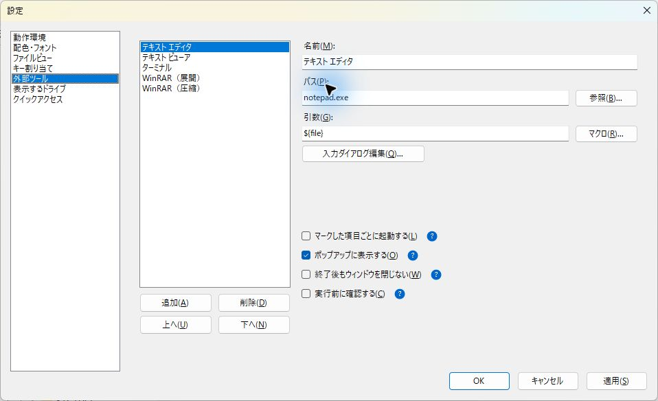
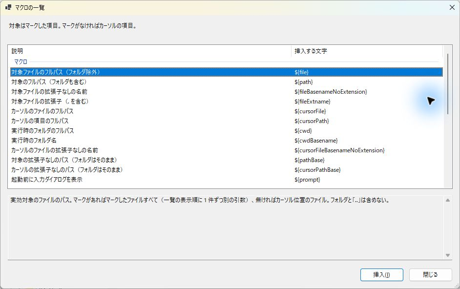
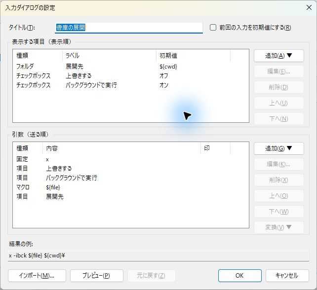
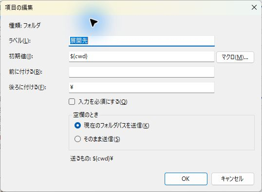
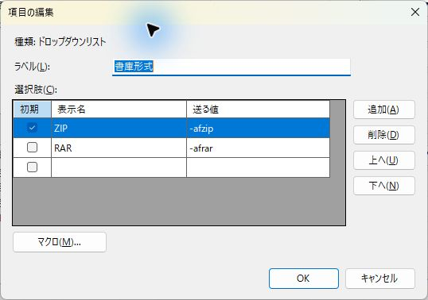

# 外部ツールの設定

ReTAC から任意のプログラムを起動する機能です。エディタやターミナルのほか、スクリプトや git コマンドも登録できます。

- 設定画面は「設定」メニューの「外部ツールの設定」で開きます。
- 登録したツールは、メニュー、ポップアップメニュー（デフォルトキー `G`）の「外部ツール ▶」、キー割り当てから起動できます。
- ツールは常に**カレントフォルダを作業ディレクトリとして**起動します。

## 設定画面

左の一覧でツールを選び、右の欄で編集します。一覧の並びが、メニューとポップアップでの並びになります。

| 項目 | 説明 |
|---|---|
| 追加／削除／上へ／下へ | ツールの追加・削除と、並びの変更 |
| 名前 | メニューとポップアップに出る名前。空では保存できない |
| パス | 実行ファイル。`git.exe` のように名前だけでもよい（`PATH` と App Paths から探す）。「参照」でファイルを選べる |
| 引数 | ツールに渡す引数。マクロを書ける（下記）。「マクロ」ボタンで一覧から選んで挿入できる |

パスが見つからないときや、`.py` などの実行できない種類のファイルを指定したときは、欄の下に注意が出ます。注意が出ても保存はできます。実行できない種類のときは「実行できる書き方を見る」のリンクが出て、スクリプトの書き方の例を確認できます。

引数に誤り（存在しないマクロ、閉じていない引用符など）があるときは保存できません。

### GUI でツールを登録する

例として、選んだファイルをテキスト エディタで開く設定を作ります。

1. 「設定」→「外部ツールの設定」を開きます。
2. 「追加」を押し、「名前」にメニューへ表示する名前を入力します。既存のツールを直す場合は、左の一覧から選びます。
3. 「パス」に実行ファイルを指定します。例えばメモ帳なら `notepad.exe` です。「参照」から選ぶと、インストール先のパスを入力できます。
4. 「引数」に `${file}` を入力します。「マクロ」から選んで「挿入」を押しても同じです。ファイルがないときは開かない設定にするなら `${file}!` にします。
5. ファイルをまとめて渡す場合は「マークした項目ごとに起動する」を OFF にします。渡した複数のファイルをどう開くかは、登録したアプリによって異なります。
6. 最初の確認では「実行前に確認する」を ON にすると、起動前に渡すコマンドラインを確認できます。
7. 設定画面の「OK」または「適用」で保存します。その後、「ツール」メニューから登録した名前を選んで起動します。



GUI アプリも同じ手順で登録します。実行ファイルは「パス」、アプリが受け取るファイルやオプションは「引数」に指定します。フォルダを開くアプリへ現在のフォルダを渡すなら `${cwd}` を使います。GUI アプリでは「終了後もウィンドウを閉じない」は効きません。

入力ダイアログなどの子画面で「OK」を押しただけでは、設定ファイルには保存されません。最後に設定画面の「OK」または「適用」を押してください。「キャンセル」は、まだ適用していない編集を破棄します。

### オプション

各オプションの右にある「?」にマウスを置くと、ON と OFF の違いが表示されます。

| オプション | ON | OFF |
|---|---|---|
| マークした項目ごとに起動する | マークした数だけ、1 件ずつ順に起動する。前の 1 件が終わってから次を起動する（[外部ツールキュー](#外部ツールキュー)） | 1 回だけ起動し、マークした項目をまとめて引数に渡す |
| ポップアップに表示する | ポップアップメニュー (デフォルトキー `G` )の「外部ツール ▶」に出す | 出さない。メニューとキー割り当てからは起動できる |
| 終了後もウィンドウを閉じない | ツールが終わってもコンソールを閉じず、キーを押すまで結果を残す。終了コードが 0 以外なら、その値も表示する | 終わると同時に閉じる |
| 実行前に確認する | 実際に渡すコマンドラインを表示し、OK を押すまで起動しない | そのまま起動する |

「終了後もウィンドウを閉じない」は、コンソールを使うツール（`git.exe`、`py.exe`、`.bat` など）にだけ効きます。GUI のツールには効きません。

### マークした項目の渡し方

何を渡すかは、ツールごとに、引数のマクロと「マークした項目ごとに起動する」で決めます。

- **マークした項目をすべて渡す**: 引数に `${file}` や `${path}` を書きます。マークが無ければ、カーソル位置の 1 件を渡します。
  - 「マークした項目ごとに起動する」が OFF なら、1 回の起動でまとめて渡します。
  - ON なら、マークした数だけ、1 件ずつ順に起動します。
- **カーソル位置の 1 件だけを渡す**: 引数に `${cursorFile}` や `${cursorPath}` を書きます。マークがあっても、カーソル位置の 1 件だけを渡します。

## マクロ

引数、入力項目の初期値、チェックボックス・選択肢の送る値に書けます。マクロの一覧は「説明」「挿入する文字」の 2 列です。選ぶ前から意味を確認でき、選択後の詳細は下に表示します。挿入できない説明やスクリプト例は、文字の欄に「—」を表示します。



挿入したい行を選び、「挿入」を押します。上下キーで選んで `Enter`、または行のダブルクリックでも挿入できます。説明だけの行では挿入できません。

### 値のマクロ

マクロの一覧と同じグループに分けて並べています。

| マクロ | 値 |
|---|---|
| **対象のファイル（フォルダを除く）** | |
| `${file}` | 対象のファイルのパス。マークがあればマークしたファイルすべて（表示順に 1 件ずつ別の引数）、無ければカーソル位置のファイル。フォルダと `..` は含めない |
| `${fileBasenameNoExtension}` | `${file}` の拡張子を除いた名前（パスなし）。例: `動画.avi` → `動画` |
| `${fileExtname}` | `${file}` の拡張子（`.` を含む）。例: `動画.avi` → `.avi` |
| **対象の項目（フォルダも含む）** | |
| `${path}` | 対象の項目のパス。`${file}` と違い、フォルダも含める。`..` はカレントフォルダになる |
| `${pathBase}` | 対象の拡張子を除いたフルパス。フォルダはそのまま、`..` はカレントフォルダ |
| `${pathBasename}` | 対象の項目の名前（パスなし）。フォルダも含める。`..` なら空。例: `.\${pathBasename}` でカレントフォルダからの相対パスになる（下記） |
| `${pathBasenameNoExtension}` | `${pathBasename}` から拡張子を除いた名前。フォルダはそのまま、`..` なら空。例: `動画.avi` → `動画`、フォルダ `v1.2` → `v1.2` |
| **カーソルの項目** | |
| `${cursorFile}` | マークに関係なく、カーソル位置のファイルだけ。フォルダと `..` なら空 |
| `${cursorFileBasenameNoExtension}` | カーソル位置のファイルの拡張子を除いた名前。フォルダと `..` は空 |
| `${cursorPath}` | マークに関係なく、カーソル位置の項目だけ。`..` ならカレントフォルダ |
| `${cursorPathBase}` | カーソル位置の項目の拡張子を除いたフルパス。フォルダ・`..` の扱いは `${pathBase}` と同じ |
| `${cursorPathBasename}` | カーソル位置の項目の名前。フォルダも含める。`..` なら空 |
| `${cursorPathBasenameNoExtension}` | カーソル位置の項目の拡張子を除いた名前。フォルダはそのまま、`..` なら空 |
| **カレントフォルダ** | |
| `${cwd}` | カレントフォルダ |
| `${cwdBasename}` | カレントフォルダの名前。`C:\` は `C:`、`\\server\share\` は `share` |
| **入力ダイアログ** | |
| `${prompt}` | 起動の前に入力ダイアログを出し、入力した内容を引数にする。項目（テキスト・フォルダ・ファイル・チェックボックス・ドロップダウンリスト）と送る順は、外部ツールの設定の「入力ダイアログ編集」で決める（下記）。引数欄に 1 つだけ、それだけで 1 つの引数として書く。入力ダイアログを設定していなければ、ツールの名前のテキストを 1 つ出す |

### 書き方の規則

次の表は、引数欄・マクロを含む引数・チェックボックスと選択肢の送る値に適用します。初期値では空白や引用符を文字として扱います（[初期値と送る値のマクロ](#初期値と送る値のマクロ)）。

| 書き方 | 意味 |
|---|---|
| `!`（マクロの直後） | マクロが空になったら、ツールを起動しない。例: `${file}!`（フォルダの上では何もしない） |
| `"…"`（引用符で囲む） | マクロが空になっても、空の値 `""` として渡す。囲まなければ、その引数ごと取り除く。`!` と両方付けたら `!` が優先 |
| `$$` | `$` そのものを書く。`$${file}` は文字どおりの `${file}`、`$$$$` は文字どおりの `$$`。単独の `$`（`$env:PATH` など）はそのまま渡る |

- `${prompt}` は、前後に文字を付けず、引用符で囲まず、`!` も付けず、単独で 1 つの引数として書きます（入力が必須かどうかは項目ごとに決めます）。
- パスや入力値に空白が含まれていても、引用符の有無にかかわらず 1 つの引数として渡ります。
- 1 つの引数の中に、`${path}` 系（`${path}` `${pathBase}` `${pathBasename}` `${pathBasenameNoExtension}`）と `${file}` 系（`${file}` `${fileBasenameNoExtension}` `${fileExtname}`）を混ぜることはできません。
- ツールはカレントフォルダで起動するので、`.\${pathBasename}` と書くとカレントフォルダからの相対パスで渡せます。書庫にフルパスを入れたくない圧縮ツールで、マークしたフォルダとファイルをまとめて渡すときに使えます。ただし正しいのは、対象がカレントフォルダ直下にあるときだけです。ツリーで選んだフォルダのようにカレントフォルダの外にある対象でも名前だけになり、カレントフォルダの中の同じ名前の項目を指します。
- 260 文字を超えるフルパスは、渡す前に短い形式（8.3 形式）への変換を試みます。短縮できない場合は元のパスを渡します。外部のアプリが長いパスを扱えないことがあるためです。

### 入力ダイアログ

引数欄に `${prompt}` を書くと、起動の前に 1 つのダイアログで入力を求めます。キャンセルすると起動しません。中身は、外部ツールの設定の「入力ダイアログ編集」で組み立てます。

- **表示する項目**（10 個まで）: テキスト・フォルダ（履歴・クイックアクセス・参照から選べる）・ファイル・チェックボックス・ドロップダウンリスト。
- **引数（送る順）**: 固定の引数・マクロを含む引数（`${file}` など）・項目を、送る順に並べます。表示する順とは別に決められるので、項目の間に `${file}` を挟めます。引数欄の `${prompt}` の位置に、この並びが入ります。
- テキスト・フォルダ・ファイルには「前に付ける」「後ろに付ける」文字を設定できます。空白で区切ると別の引数、区切らなければ値とつながります（`-o` を前に付けると `-oE:\展開先`、`-m ` を前に付けると `-m` と値の 2 つ）。テキスト・ファイルは、空欄なら付けた文字ごと送りません。テキスト・フォルダ・ファイルは「入力を必須にする」にすると、空欄では閉じません。
- 任意のフォルダ項目は、空欄なら「現在のフォルダパスを送信」するか、「そのまま送信」するかを選べます。そのまま送信では、長さ 0 の値を 1 引数として渡し、前後に付ける文字も使います。`-o` を前に付けると `-o`、`-o ` なら `-o` と空の値の 2 引数になります。必須をオンにしても、この選択は保持されます。
- ドロップダウンリストの選択肢には、表示名と送る値があります。送る値が空の選択肢を選ぶと、何も送りません（「指定しない」という選択肢に使えます）。
- フォルダに入力したパスは、フォルダ履歴に入ります。空欄は入りません。相対パスはカレントフォルダ基準で絶対パスにし、不正なパスは入力欄へ戻します。パスの存在は調べません。
- 「前回の入力を初期値にする」をオンにすると、次からは前回 OK した値で開きます。前回の文字は空欄も含めて優先し、マクロとして解釈し直しません。「初期値に戻す」は、起動時の対象で初期値を展開し直します。展開が失敗したときは、入力済みの全欄を保持します。
- 「インポート」に、ふだん打っているコマンドラインを貼り付けると、パスと引数が読み込まれます。引数の行を選んで「変換」を押すと、テキスト・フォルダ・ファイル・チェックボックス・ドロップダウンリストの項目や `${file}` などに変えられます。続いた複数の行は、1 つのチェックボックスにまとめられます（`-c:v` と `copy` をまとめてオン・オフする、など）。
- 「プレビュー」で、実際に出るダイアログを確かめられます。ファイル・カーソルの対象はなく、カレントフォルダだけを使います。起動・履歴の登録・前回値の保存は行いません。結果の例には、マクロを未展開のまま表示します。
- 「元に戻す」または `Ctrl`+`Z` で、入力ダイアログ編集の操作（項目と引数の追加・編集・削除・並べ替え、変換、まとめる、インポート）を 1 つずつ戻せます。タイトルの欄での `Ctrl`+`Z` は、その欄の文字の取り消しです。
- 項目も引数も空のまま OK すると、入力ダイアログを設定していない扱いになります。起動すると、ツールの名前をラベルにしたテキストを 1 つ出します。

#### GUI で入力ダイアログを作る

ツールを選び、「入力ダイアログ編集」を押します。上の「表示する項目」は画面に並ぶ順、下の「引数」はツールへ送る順です。

1. 必要なら「タイトル」を入力します。空欄ならツールの名前を使います。
2. 上の「追加 ▼」から、テキスト・フォルダ・ファイル・チェックボックス・ドロップダウンリストを選びます。
3. 項目の編集画面で「ラベル」と、種類に応じた初期値や送る値を設定し、「OK」を押します。作った項目は、下の引数の末尾にも追加されます。
4. 固定のオプションやマクロを挟む場合は、下の「追加 ▼」で「固定の引数...」または「マクロを含む引数...」を選びます。
5. 上下それぞれの「上へ」「下へ」で順序を整えます。例えば WinRAR の展開では、送る順を `x` → 上書きの値 → バックグラウンドの値 → `${file}` → 展開先にします。
6. 「プレビュー」で入力画面を確かめます。プレビューではツールを起動しません。最後に編集画面の「OK」、設定画面の「OK」または「適用」で保存します。新しく作った入力ダイアログは、引数欄へ `${prompt}` が自動で追加されます。



フォルダ項目では、初期値に `${cwd}` を入れると起動時のフォルダを表示します。「マクロ」からも挿入できます。「入力を必須にする」が OFF の場合は、「空欄のとき」で送る値を選びます。ON の場合は空欄で確定できません。



チェックボックスは「送る値」と「初期値をオンにする」を設定します。ドロップダウンリストは、選択肢ごとに「表示名」「送る値」を入力し、最初に選ぶ行の「初期」にチェックします。選択中の行の「送る値」へ「マクロ」から挿入できます。



#### GUI でインポートした行を変換する

1. 入力ダイアログの編集画面で「インポート」を押し、コマンドライン全体を貼り付けます。「OK」でパスと引数を読み込みます。
2. 下の引数の一覧から固定の行を 1 つ選び、「変換 ▼」で作りたい項目の種類を選びます。パスの行でも、フォルダ・ファイルを含む全 5 種類へ変換できます。
3. 新しく選ばれた上の項目を「編集...」で開き、ラベルや初期値を整えます。フォルダ・ファイルなら元の値が初期値に入り、ドロップダウンリストなら最初の選択肢の表示名と送る値に入ります。
4. 下書きが未完成でも変換自体はできます。保存時にエラーが出る場合は項目を直し、「プレビュー」で確かめてから保存します。取り消す場合は「元に戻す」を押します。

例えば、インポートした展開先のパスをフォルダ項目へ、書庫形式の `-afzip` をドロップダウンリストへ変換できます。ドロップダウンリストの最初の表示名を `ZIP` に直し、`RAR` / `-afrar` の行を追加すると、画面で書庫形式を選べます。

#### 初期値と送る値のマクロ

初期値の横の「マクロ」から、テキスト・フォルダ・ファイルに挿入できます。ダイアログを開くときに、マクロごとに先頭の 1 件を使います。例えばフォルダと `a.txt`・`b.txt` をマークすると、`${path}` は先頭のフォルダ、`${fileBasenameNoExtension}` はファイルだけの先頭の `a` になります。空白・タブ・引用符は初期値の文字として残ります。`${file}!` のような必須マクロが空なら、ダイアログを開かずに理由を表示します。

チェックボックスと選択肢の送る値は、引数欄と同じ文法です。`${file}` は対象ファイルをそれぞれ別の引数へ展開し、オフの項目や未選択の値は実行時に展開しません。「項目ごとに起動する」なら、その回の対象で値を求めます。カーソルとカレントフォルダは起動の操作時に固定します。

名前だけの `${cwdBasename}` も、フォルダ・ファイルの初期値で使えます。パスの処理は通常どおりなので、`work` になればカレントフォルダ基準の `work` を指します。利用者が入力した文字、ラベル、表示名、前後に付ける文字はマクロとして解析しません。初期値と送る値では `${prompt}` を入れ子にできません。オフのチェックボックスや未選択の選択肢を含め、すべての初期値・送る値を保存時に構文検査します。

拡張子なしのパスは、最後の `.` 以降を除きます。`C:\work\archive.tar.gz` は `C:\work\archive.tar`、`.gitignore` は親フォルダの `C:\work\` になります。フォルダ名のドットは残します。長いフルパスは元のパスを短縮してから拡張子を除き、名前だけのマクロと初期値の表示は短縮しません。

**インポートと変換の例**

```text
C:\Program Files\WinRAR\WinRAR.exe a -afzip -m5 backup.zip "C:\Data\*"
```

この入力ではパスが `C:\Program Files\WinRAR\WinRAR.exe`、最初の引数が `a` になります。空白を含むパスは引用符で囲んでも読み込めます。実行ファイルの境界を判定できないときは、パス全体を引用符で囲んでください。

インポートした固定の引数は、`${file}` や `$$` も書いた文字のまま送ります。マクロ欄で文字どおりの `${file}` を書くときは `$${file}`、`$$` を書くときは `$$$$` を使います。項目へ変換すると、このエスケープを自動で補います。表示するラベルと選択肢の表示名は元の文字です。

固定の行からは、空欄や引用符を含む値も全 5 種類へ変換できます。ドロップダウンは、元の値を最初の表示名と送る値へ入れます。下書きが未完成なら、変換後に直して保存してください。引用符を送る値の文法で表せないときは、元の文字を下書きに残して編集を案内します。パス項目の空欄や相対パスは項目側の規則に従うため、固定の行と送る内容が変わる場合があります。10 項目あるときは、項目への候補を表示したまま無効にします。

**3.0.0 までの書き方を使っていた場合:** `${prompt:タイトル}{既定値}`・`${prompt}!`・`--name=${prompt}` のような書き方は使えません。引数欄を `${prompt}` だけにし、タイトル・既定値（初期値）・必須・つなげていた文字（前に付ける）を「入力ダイアログ編集」で設定し直してください。

**例: WinRAR で、選んだ書庫を指定したフォルダへ展開する**

| 項目 | 種類 | 設定 |
|---|---|---|
| 展開先 | フォルダ | 後ろに付ける: `\` |
| 上書きする | チェックボックス | 送る値: `-o+` |
| バックグラウンドで実行 | チェックボックス | 送る値: `-ibck`、初期値: オン |

引数（送る順）: 固定の引数 `x` → 項目「上書きする」→ 項目「バックグラウンドで実行」→ マクロを含む引数 `${file}` → 項目「展開先」。引数欄は `${prompt}` だけ。

## 設定例

パスはインストール先に合わせて読み替えてください。

### テキスト エディタ

| 名前 | パス | 引数 | 備考 |
|---|---|---|---|
| メモ帳 | `notepad.exe` | `${file}` | 初期登録の設定。対象が無いときは空のまま開く |
| メモ帳（閲覧用） | `notepad.exe` | `${file}!` | 対象が無いときは起動しない |
| VS Code | `C:\Users\<ユーザー>\AppData\Local\Programs\Microsoft VS Code\Code.exe` | `${file}` | |
| VS Code（フォルダを開く） | 同上 | `${cwd}` | |

複数のファイルをまとめて開くには、ツールの「マークした項目ごとに起動する」を OFF にします。`${file}` がマークしたファイルの数だけ並んで渡ります。

### Python スクリプト

スクリプトはパスではなく**引数**に書き、フルパスで指定します。作業ディレクトリがカレントフォルダになるため、相対パスではスクリプトが見つかりません。

| 名前 | パス | 引数 | 備考 |
|---|---|---|---|
| スクリプト実行 | `py.exe` | `"C:\tools\script.py"` | |
| スクリプト実行（仮想環境） | `C:\work\.venv\Scripts\python.exe` | `"C:\work\script.py"` | |
| 選択中のファイルを引数として渡す | `py.exe` | `"C:\tools\convert.py" ${file}!` | |

- 結果を見たいときは「終了後もウィンドウを閉じない」を ON にします。
- 重い処理を複数のファイルごとに実行するときは、「マークした項目ごとに起動する」を ON にします。前の 1 件が終わってから次が始まります。
- パスに `.py` ファイルを直接書くことはできません。

その他のスクリプトの例です。

| 名前 | パス | 引数 | 備考 |
|---|---|---|---|
| PowerShell 7 | `pwsh.exe` | `-File "C:\tools\build.ps1"` | |
| Windows PowerShell | `powershell.exe` | `-ExecutionPolicy Bypass -File "C:\tools\build.ps1"` | |
| Node.js | `node.exe` | `"C:\tools\script.js"` | |
| バッチファイル | `C:\tools\build.bat` | （なし） | パスに直接書ける |

バッチファイルはパスに直接書けます。バッチファイル自身の場所は `%~dp0`、受け取った引数は `%~1` で参照します。カレントフォルダがネットワーク上（`\\サーバー\共有`）にあると、cmd.exe は `C:\Windows` で動くため、バッチの中で `pushd` してください。

### ターミナル

| 名前 | パス | 引数 | 備考 |
|---|---|---|---|
| コマンド プロンプト | `cmd.exe` | （なし） | 初期登録の設定 |
| PowerShell 7 | `pwsh.exe` | （なし） | |
| Git Bash | `C:\Program Files\Git\git-bash.exe` | （なし） | |
| Windows Terminal | `wt.exe` | `-d ${cwd}` | |

- 対話型のシェルは自分では終了しないので、「終了後もウィンドウを閉じない」は不要です。
- `git-bash.exe` は専用の端末ウィンドウ（mintty）を開く起動用のプログラムで、Windows からは GUI のプログラムとして扱われます。そのため「終了後もウィンドウを閉じない」は効きません。bash でスクリプトを実行して結果を残したいときは、パスに `C:\Program Files\Git\bin\bash.exe` を指定します（コンソールのプログラムなので、このオプションが効きます）。
- Windows Terminal はプロファイルの開始フォルダで開くことがあるため、`-d ${cwd}` でフォルダを指定します。

### 圧縮

マークしたフォルダとファイルをまとめて 1 つの書庫にします。書庫の中のパスは、カレントフォルダからの相対パスになります。

| 名前 | パス | 引数 | 備考 |
|---|---|---|---|
| ZIP に圧縮（tar） | `tar.exe` | `-a -cf "${cwdBasename}.zip" .\${pathBasename}!` | Windows 標準の tar。`-a` で書庫の形式を拡張子から決める |
| 7z に圧縮（7-Zip） | `C:\Program Files\7-Zip\7z.exe` | `a "${cwdBasename}.7z" ${path}!` | 7-Zip はフルパスで渡しても、書庫には最後の名前だけを入れる |

- 「マークした項目ごとに起動する」を OFF にします。ON にすると 1 件ずつ別々に起動します（tar では書庫が上書きされ、最後の 1 件だけが残ります）。
- 書庫はカレントフォルダに、カレントフォルダの名前で作ります。
- `!` を付けているので、カーソルが `..` の上でマークも無いときは起動しません。
- `.\${pathBasename}` が正しいのは、対象がカレントフォルダ直下にあるときだけです。ツリーにフォーカスがあるときは使わないでください。

### git コマンド

git はカレントフォルダのリポジトリに対して動きます。ReTAC でリポジトリ内のフォルダを開いた状態で実行してください。

**設定のコツ**

- **「終了後もウィンドウを閉じない」を ON にします。** `git.exe` はコンソールのツールなので、OFF だと結果を読む前にウィンドウが閉じます。
- **ページャーを止めます。** `log` や `diff` はページャーを起動し、`q` を押すまで終わりません。引数の先頭に `--no-pager` を付けると、結果がそのまま流れます。
- **エディタを開かせません。** `commit` でメッセージを省くとエディタが開きます。入力ダイアログのテキストの項目（前に付ける: `-m `〔末尾に空白〕、入力を必須にする: オン）でメッセージを渡します。
- **取り消せない操作には「実行前に確認する」を ON にします。** `restore` や `reset` など、作業内容が消える操作が対象です。
- **1 回で済む操作は「マークした項目ごとに起動する」を OFF にします。** `git add` などはファイルをまとめて渡せば 1 回で終わります。ON にすると 1 件ずつ順番に実行されます（同時には走らないので、`index.lock` の競合は起きません）。

**設定例**（「終了後もウィンドウを閉じない」はすべて ON）

| 名前 | パス | 引数 | 備考 |
|---|---|---|---|
| git status | `git.exe` | `status` | |
| git log | `git.exe` | `--no-pager log --oneline --graph -30` | |
| git log（このファイル） | `git.exe` | `--no-pager log --oneline --follow -- ${cursorFile}!` | |
| git diff | `git.exe` | `--no-pager diff` | |
| git diff（このファイル） | `git.exe` | `--no-pager diff -- ${file}!` | |
| git diff（ステージ済み） | `git.exe` | `--no-pager diff --cached` | |
| git blame | `git.exe` | `--no-pager blame -- ${cursorFile}!` | |
| git add | `git.exe` | `add -- ${path}!` | |
| git add（すべて） | `git.exe` | `add -A` | |
| git commit | `git.exe` | `commit ${prompt}` | 入力ダイアログ: テキスト「コミットメッセージ」（前に付ける: `-m `・必須） |
| git add + commit（変更済みすべて） | `git.exe` | `commit -a ${prompt}` | 入力ダイアログ: テキスト「コミットメッセージ」（前に付ける: `-m `・必須） |
| git init + add + commit（リポジトリ作成） | `pwsh.exe` | `-NoProfile -Command "git init && git add . && git commit -m 'init'"` | 複数のコマンドを続けて実行する例（下記） |
| git restore（変更の取り消し） | `git.exe` | `restore -- ${file}!` | 実行前に確認する: ON |
| git restore --staged（ステージの取り消し） | `git.exe` | `restore --staged -- ${path}!` | |
| git pull | `git.exe` | `pull` | |
| git push | `git.exe` | `push` | |
| git fetch | `git.exe` | `fetch --prune` | |
| git switch（ブランチ切り替え） | `git.exe` | `switch ${prompt}` | 入力ダイアログ: テキスト「ブランチ名」（必須） |
| git switch -c（ブランチ作成） | `git.exe` | `switch -c ${prompt}` | 入力ダイアログ: テキスト「新しいブランチ名」（必須） |
| git branch（一覧） | `git.exe` | `--no-pager branch -a` | |
| git stash | `git.exe` | `stash push ${prompt}` | 入力ダイアログ: テキスト「メモ」（前に付ける: `-m `・初期値: `作業中`） |
| git stash pop | `git.exe` | `stash pop` | 実行前に確認する: ON |
| git tag | `git.exe` | `tag ${prompt}` | 入力ダイアログ: テキスト「タグ名」（必須） |
| git rm（管理から外す） | `git.exe` | `rm --cached -- ${path}!` | 実行前に確認する: ON |

- **複数のコマンドを続けて実行するとき**は、パスに `pwsh.exe` を指定し、コマンド全体を `"…"` で囲んで `-Command` に渡します。`git.exe` 自体は 1 回に 1 つのコマンドしか実行できません。
  - `&&` でつなぐと、前のコマンドが失敗した時点で止まります。`;` でつなぐと、失敗しても次へ進みます。
  - コマンドの中で引用符が必要なときは、`'…'`（単一引用符）を使います。`"` は ReTAC の引数の区切りとして扱われます。
  - コミットメッセージを都度入力するなら、引数欄を `-NoProfile -Command ${prompt}` にし、入力ダイアログのテキストの項目（初期値: `init`）に、前に付ける: `"git init && git add . && git commit -m '"`、後ろに付ける: `'` を設定します（前後の文字が値とつながり、コマンド全体が 1 つの引数になります）。ただし入力に `'` を含めると、コマンドが壊れます。
- `--` は、ファイル名とブランチ名などを区別するための区切りです。`-` で始まる名前のファイルも安全に渡せます。
- git の GUI を登録するときは、パスに `C:\Program Files\Git\cmd\gitk.exe` や `C:\Program Files\Git\cmd\git-gui.exe` を指定します。GUI なので「終了後もウィンドウを閉じない」は不要です。

## 外部ツールキュー

「マークした項目ごとに起動する」が ON のツールは、外部ツールキューで順番に処理します。前の 1 件が終わってから次の 1 件を起動するため、重い変換処理や git の操作が同時に走ることはありません。キューの処理中も ReTAC は操作できます。

- **起動前の確認**: 10 回以上起動するときは、起動の前に確認します。「実行前に確認する」が ON なら、この確認に 1 件目のコマンドラインも表示されます。
- **進行状況**: ステータスバーに「ツール名 3/50」の形で表示します。終わると「ツール名 完了 50 件（失敗 1）」のように結果が残ります。タスクバーのボタンにも進行バーが出ます。
- **進行状況ウィンドウ**: ステータスバーの表示をクリックするか、コマンド「外部ツールキュー」で開きます。キューの各項目の状態（待ち・実行中・完了・失敗・強制終了・取りやめ）が一覧で表示されます。このウィンドウは自動では開きません。閉じてもキューは止まりません。
- **停止**: 待っている分を取りやめます。動いている 1 件は最後まで実行します。
- **この 1 件を強制終了**: 動いている 1 件を、それが起動した子プロセスも含めて終了します。書きかけのファイルが残ることがあります。ツールが管理者権限で動いている場合は終了できません。
- **失敗時**: 1 件が起動できなかった、または終了コードが 0 以外でも、キューは次の 1 件へ進みます。
- **追加**: 処理中に同じ操作をすると、今のキューの末尾に追加されます。
- **ReTAC の終了時**: 待っている分があれば確認します。終了を選ぶと待っている分を取りやめます。動いている 1 件は止めません。
- キューはウィンドウをいくつ開いていても 1 つだけです。
